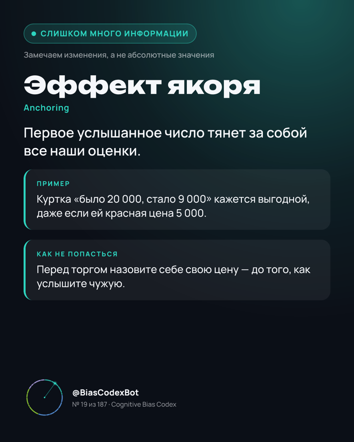
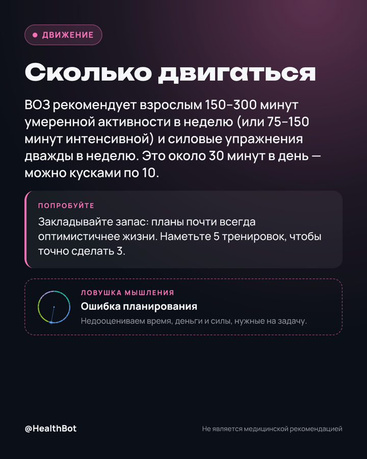
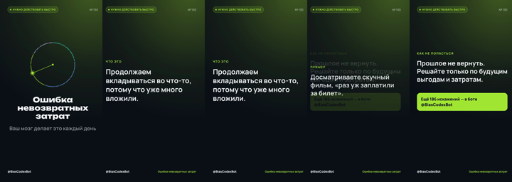
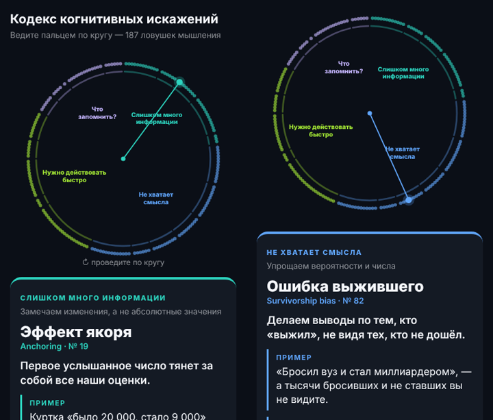
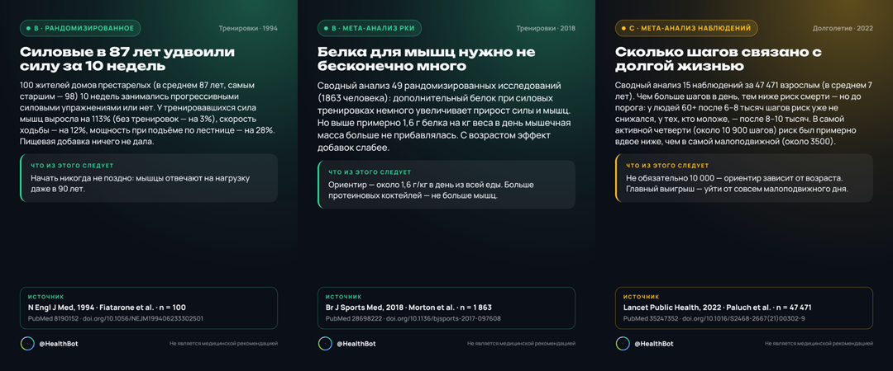

# Боты «Кодекс когнитивных искажений» и «ЗОЖ без самообмана»

Два Telegram-бота, интерактивная карта (Mini App) и конвейер коротких роликов для n8n — всё на
одном наборе данных: [The Cognitive Bias Codex](https://commons.wikimedia.org/wiki/File:Cognitive_bias_codex_en.svg)
(188 искажений, 4 ветви, 20 групп), распарсенном из открытого SVG с Wikimedia Commons.

| | |
|---|---|
|  |  |
| Карточка искажения: что это, пример, как не попасться; колесо показывает место в кодексе | Совет ЗОЖ-бота, привязанный к «ловушке мышления» |




## Что внутри

* **`data/biases.json`** — 187 искажений (у «Negativity bias» в кодексе два места): русское название,
  суть, пример из жизни, совет «как не попасться», ветвь и группа кодекса, угол на круге, ссылки на
  ru/en Википедию и выдержки из неё. Русские тексты — в `data/ru/*.json` (правьте там), остальное
  собирает `npm run parse`.
* **Бот 1 — Кодекс** (`src/bias-bot`): карточка-картинка с подписью, искажение дня с подпиской
  (выбор часа), карта кодекса кнопками (ветвь → группа → искажение), квиз «угадай по примеру» со
  счётом и сериями, поиск по любому слову, inline-режим (поделиться карточкой в любом чате),
  автопост в канал, кросс-промо во второй бот, `/stats`.
* **Бот 2 — ЗОЖ без самообмана** (`src/health-bot`): 30 советов по питанию, движению, мотивации и
  сну (`data/health-ru.json`), у каждого — ловушка мышления со ссылкой в Кодекс; трекер 1–3 привычек
  с сериями дней, недельной сводкой и вечерним напоминанием.
* **Рубрика «🔬 Доказано наукой»** в ЗОЖ-боте — 23 малоизвестных факта про тело: питание,
  тренировки, сон, долголетие, добавки. У каждого — уровень доказанности (A — двойное слепое РКИ,
  B — рандомизированное исследование или мета-анализ РКИ, C — наблюдение), проверенный по PubMed.
  3 факта бесплатно (по одному на уровень), остальное — «за чашку кофе» в Telegram Stars.
* **Рубрика «🎭 Плацебо и мифы»** в Кодексе — 9 бесплатных разборов (ноцебо, «операции-пустышки»,
  пищевые страшилки), только уровень A. В конце ведёт в «Доказано наукой» ЗОЖ-бота.
* **Mini App** (`webapp/index.html`) — та самая интерактивная карта: ведёте пальцем по кругу —
  выбирается искажение, поиск, список по группам, кнопка «Карточка в чат».
* **Карточки** (`src/lib/cards.mjs`) — satori + resvg, без браузера, ~100 мс на картинку:
  пост 1080×1350, сторис 1080×1920, кадры роликов. Бот рисует на лету и кеширует `file_id`.
* **Ролики, два стиля.** `dynamic` (по умолчанию, `video/` на Remotion): слова влетают по одному,
  колесо кодекса собирается точками и рисует луч к искажению, маркер прокрашивает ключевые слова,
  карточка-пример переворачивается в 3D, переходы «вжиком» с размытием, частицы, зерно, полоса
  прогресса, в финале — настоящая карточка из бота. `simple` (`src/lib/video.mjs`): 4 слайда на
  ffmpeg с панорамой. В обоих озвучка и музыка по желанию, длительность подгоняется под озвучку.
* **Сценарии роликов** (`src/lib/script.mjs`) — Claude (`claude-opus-5-5`, структурированный JSON:
  крючок, озвучка, заголовок, описание, хештеги); без ключа — шаблон из карточки.
* **HTTP API** (`src/api/server.mjs`) — для n8n: искажение дня, следующее без ролика, сценарий,
  карточки, рендер mp4, отметка «опубликовано», статистика воронки. Заодно раздаёт Mini App.
* **n8n** (`n8n/*.json`) — ролик дня → канал (+ YouTube Shorts), и еженедельный отчёт по воронке.
* **Воронка** — [`docs/funnel.md`](docs/funnel.md): схема, метки источников, метрики, рубрики.

## Запуск

Нужен Node.js ≥ 22.13 (встроенный SQLite) и ffmpeg (только для роликов).

```bash
cd bias-bots
npm install
cp .env.example .env        # впишите токены от @BotFather и имена ботов
npm run bias-bot            # бот «Кодекс»
npm run health-bot          # бот «ЗОЖ»
npm run api                 # API для n8n + Mini App на http://localhost:8787/webapp/
```

Или всё сразу в Docker: `docker compose up -d` (база — в `./state`).

В @BotFather для бота «Кодекс» включите inline-режим (`/setinline`) — так карточками можно делиться
в любом чате. Чтобы постить в канал, добавьте бота админом и задайте `CHANNEL_ID`.

### Mini App

Нужен HTTPS-адрес. Варианты:
* API за reverse-proxy с сертификатом → `WEBAPP_URL=https://ваш-домен/webapp/`;
* GitHub Pages этого репозитория (страница статическая, данные берёт из `../data/biases.json`) →
  `WEBAPP_URL=https://<user>.github.io/<repo>/bias-bots/webapp/`.

Кнопка «🌀 Интерактивная карта» появится в разделе «Карта кодекса», бот сам добавит `?bot=<имя>`.

### Динамичные ролики (Remotion)

Шаблон — React-компоненты в `video/` (`BiasReel.jsx` — сцены, `fx.jsx` — эффекты, `timeline.mjs` —
раскадровка). Все эффекты на CSS/SVG, без WebGL, поэтому рендер идёт на любом сервере с
headless-браузером. 22-секундный ролик рендерится около минуты на 4 ядрах. Править шаблон удобно
в Remotion Studio: `npm run studio` — откроется редактор с предпросмотром и таймлайном.

Remotion бесплатен для частных лиц и компаний до 3 человек; компаниям больше — платная лицензия
(remotion.pro). Простой стиль на ffmpeg от Remotion не зависит.

### Карточки и ролики вручную

```bash
npm run cards                                   # все 187 карточек → out/cards/post/
npm run cards -- --format story --only anchoring,halo-effect
npm run video -- --id sunk-cost-fallacy --cover # динамичный ролик + обложка → out/videos/
npm run video -- --id 130 --style simple        # простой стиль (ffmpeg)
npm run video -- --today --script --audio voice.mp3 --music bg.mp3
```

### n8n

Подходит бесплатная self-hosted версия (Community Edition): в ней все интеграции, а оба воркфлоу
используют только встроенные узлы (Schedule, HTTP Request, IF, Set, Code, Telegram, YouTube).
Лицензия Sustainable Use License разрешает использовать n8n для своих внутренних задач — как здесь;
нельзя продавать n8n как сервис или давать клиентам строить в нём свои воркфлоу без договора с n8n.
Ролик в день — около 30 запусков в месяц, так что подойдёт и самый дешёвый облачный тариф.

1. Импортируйте `n8n/bias-reels.json` и `n8n/funnel-report.json` (Workflows → Import from file).
2. Создайте учётные данные: *Header Auth* `x-api-key` = ваш `API_KEY`; *Header Auth* `xi-api-key`
   для ElevenLabs; *Telegram API* — токен бота-админа канала; (по желанию) *YouTube OAuth2*.
3. В узле «Настройки» — адрес API, канал, голос ElevenLabs (`use_tts=false` — без озвучки).
4. Узел YouTube выключен — включите после подключения аккаунта и проверьте поля.

Сценарий пишет сервер (узел «Сценарий (Claude)» зовёт `/api/bias/:id/script`), поэтому ключ
Anthropic хранится в `.env` сервера, а не в n8n. Озвучку можно заменить на любой TTS, который
отдаёт mp3, — API принимает аудио телом запроса.

## Рубрики с фактами и оплата



Факты лежат в `data/facts-ru.json`: у каждого PMID, рубрика (`health` — «Доказано наукой» в
ЗОЖ-боте, `myths` — «Плацебо и мифы» в Кодексе), уровень доказанности, тексты и связанное искажение.

**Уровни и как они проверяются.** `npm run verify-facts` забирает записи через NCBI E-utilities и
требует, чтобы запись PubMed подтверждала заявленный уровень:

| Уровень | Что это | Что должно быть в записи PubMed |
|---|---|---|
| A | рандомизированное двойное слепое | тип «Randomized Controlled Trial» или «randomized / randomly assigned» **и** «double-blind / double-masked / double-dummy» |
| B | рандомизированное или мета-анализ РКИ | рандомизация (как выше) или мета-анализ/обзор, где сказано про randomized controlled trials |
| C | наблюдение — связь, а не причина | тип «Observational Study» или когорта/проспективное наблюдение |

Результат с цитатами-доказательствами сохраняется в `data/facts-pubmed.json`; боты показывают только
факты с подтверждённым уровнем, а цитата попадает в подпись. Добавить факт: допишите его в
`data/facts-ru.json` → `npm run verify-facts` → `npm test`.

Почему уровни, а не только двойные слепые: тренировки и диеты почти невозможно исследовать вслепую
(человек знает, что бегает), поэтому строгое «только A» оставило бы рубрику без тела — одни добавки
и плацебо. Значок уровня на карточке честно говорит, насколько твёрдый вывод.

**Оплата.** Цифровые товары в Telegram продаются только за Telegram Stars (валюта `XTR`),
платёжный провайдер и юрлицо для этого не нужны. Цена — `FACTS_PRICE_STARS` (по умолчанию 50 ⭐;
сколько это в долларах, зависит от того, где пользователь покупает звёзды). Звёзды копятся на
балансе бота; вывод и траты — в @BotFather → бот → Payments/Balance.

В ЗОЖ-боте: `/facts` — рубрика, `/buy` — счёт, `/terms` — условия, `/paysupport` — сообщение
администраторам (Telegram требует эти команды у платных ботов), `/refund <user_id>` — возврат
звёзд (только для `ADMIN_IDS`). В Кодексе: `/myths`. Покупки — в таблице `purchases`, выручка видна
в `/stats`, `GET /api/stats` и еженедельном отчёте n8n.

## Обновить данные

```bash
npm run parse              # из кеша data/raw (офлайн)
npm run parse -- --refresh # заново скачать SVG и Википедию
```

Парсер берёт структуру и ссылки из SVG кодекса, через API Википедии находит русские статьи и
вступления, сшивает с «Списком когнитивных искажений» в ru-Википедии и накладывает ручные тексты
из `data/ru/`. Если в кодексе появится искажение без ручного текста, парсер перечислит его.

## Тесты

```bash
npm test
```

Боты тестируются офлайн: все вызовы Telegram Bot API перехватываются (`test/harness.mjs`), сценарии
прогоняются через `bot.handleUpdate` — старт и диплинки, кеш `file_id`, поиск, карта, квиз,
подписка и рассылка без дублей, пост в канал, кросс-промо, inline, трекер и серии, напоминания.
Плюс API (включая рендер mp4), проверка связей в n8n-воркфлоу, правило уровней доказанности,
обе рубрики фактов и платёжный сценарий в Stars (витрина → пейволл → счёт → pre-checkout → оплата →
доступ → поддержка → возврат).

## Лицензии

Схема кодекса — CC BY-SA 4.0 (дизайн John Manoogian III, категории Buster Benson). Выдержки из
Википедии — CC BY-SA 4.0. Шрифты Manrope, Unbounded — OFL; DejaVu — свободная лицензия.
ЗОЖ-советы — общие рекомендации (ВОЗ и др.), не медицинская консультация.
